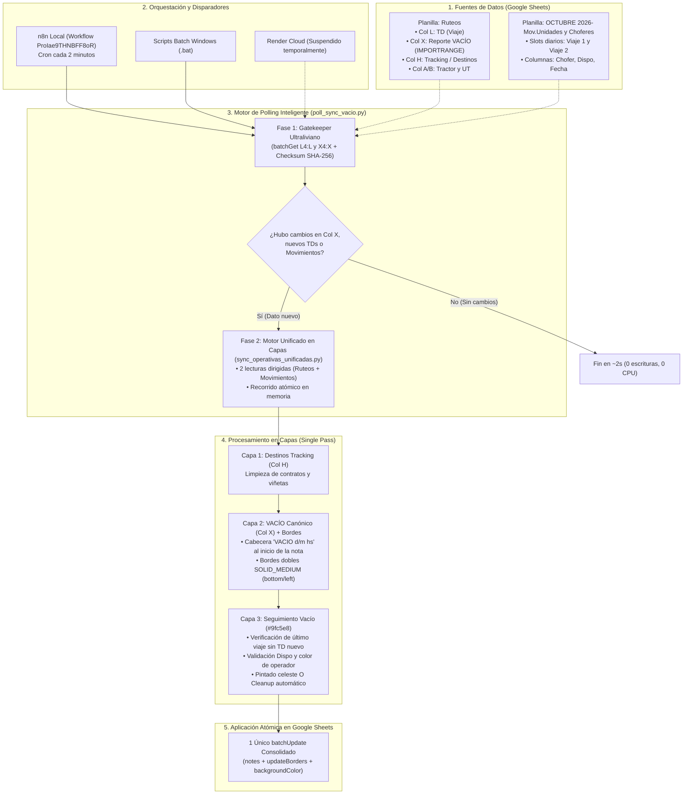

# 🚀 Central Operativa Diaria: Sincronizaciones, Polling Inteligente & Orquestación

Repositorio centralizado que consolida todas las integraciones, reglas de negocio, sincronizadores y motores de orquestación operativa entre las planillas de **Ruteos** y **Movimientos Mensuales**:
📁 `C:\Users\Matias Rodriguez\Documents\diaria`

Diseñado para operar de forma híbrida: **100% autónomo en entorno local (Windows / n8n Local)** o en la nube (**Render Cloud**) con soporte para API REST y CLI.

---

## 📑 Tabla de Contenidos
1. [Arquitectura y Motor Unificado en Capas](#-arquitectura-y-motor-unificado-en-capas)
2. [Regla Canónica de Columna X y Formatos de Vacío](#-regla-canónica-de-columna-x-y-formatos-de-vacío)
3. [Motor de Polling Inteligente (Gatekeeper + Capas)](#-motor-de-polling-inteligente-gatekeeper--capas)
4. [¿Por qué el Merge de TD y Patente es Mandatorio?](#-por-qué-el-merge-de-td-y-patente-es-mandatorio)
5. [Métricas de Consumo y Cuotas de Google API](#-métricas-de-consumo-y-cuotas-de-google-api)
6. [Orquestación: n8n Local (localhost:5678) y Render Cloud](#-orquestación-n8n-local-localhost5678-y-render-cloud)
7. [Guía de Comandos y Scripts .bat](#-guía-de-comandos-y-scripts-bat)
8. [Modo Silencioso en n8n: py vs pyw](#-modo-silencioso-en-n8n-py-vs-pyw)

---

## 🌐 Arquitectura y Motor Unificado en Capas

El nuevo pipeline consolida las antiguas **Tareas 1, 2 y 3** en un **único recorrido en memoria** (`sync_operativas_unificadas.py`), realizando lecturas dirigidas y un único `batchUpdate` consolidado.



---

## 📌 Regla Canónica de Columna X y Formatos de Vacío

A partir de la optimización del pipeline, se establecen las siguientes reglas de negocio estrictas:

1. **VACÍO 100% Dependiente de Columna X**:
   * El encabezado `VACIO ...`, la aplicación de **bordes dobles** (`SOLID_MEDIUM`) y la condición previa para el pintado celeste `#9fc5e8` dependen **exclusivamente de la Columna X** de Ruteos.
   * La **Columna H** es considerada **tracking puro**: sus textos y anotaciones operativas (incluso si contienen `/14HS VACIO` u horarios) se insertan intactos en el **cuerpo de la nota** debajo del encabezado, sin ascender a cabecera ni disparar por sí mismos bordes o colores.
2. **Inclusión de Formatos de Fecha (Sin descartes)**:
   * Anteriormente, se descartaban fechas sin hora o con medianoche (`0:00`), lo que provocaba que en la sección **CAMPO** no se reconocieran los vacíos.
   * **Formatos soportados y su salida canónica**:
     * `08/10/2026` o `08/10` ➡️ `VACIO 8/10 hs`
     * `08/10/2026 0:00` ➡️ `VACIO 8/10 hs`
     * `04/10/2026 8:10:00` ➡️ `VACIO 4/10 8:10 hs`
     * `05/10/26 23 HS` ➡️ `VACIO 5/10 23:00 hs`
     * `07/10 23:40` ➡️ `VACIO 7/10 23:40 hs`
     * `VACIO` ➡️ `VACIO`
   * **Valores descartados (falsos vacíos)**: `FALSE`, `TRUE`, `#N/A`, `TLC`, `TPH`, `NO`, `""`.
3. **Estructura Final de la Nota Hover**:
   ```
   VACIO 8/10 hs                                   <-- Capa 2 (Col X)
   • 31349 - RIO NEUQUEN COMBUSTIBLES S.A.        <-- Capa 1 (Destinos Col H)
   15:30 00029 /14:10 Arroyito                    <-- Capa 1 (Tránsito Col H)
   ```

---

## ⚡ Motor de Polling Inteligente (Gatekeeper + Capas)

### Fase 1: Gatekeeper Ultraliviano (~2 seg)
1. **Consulta mínima atómica**: Realiza una llamada `batchGet` solicitando exclusivamente `Ruteos!L4:L` (TDs), `Ruteos!X4:X` (Vacíos) y las columnas del día en `Movimientos`.
2. **Checksum SHA-256**: Genera una firma criptográfica y la compara con [`last_poll_state.json`](./last_poll_state.json).
3. **Abrupt Exit**: Si el hash no cambió, aborta en **~2 segundos con 0 escrituras y 0 consumo pesado**.

### Fase 2: Ejecución Unificada en Memoria (`sync_operativas_unificadas.py`)
Si el Gatekeeper detecta novedades (o se pasa `--force`):
1. Carga `Ruteos!A4:AL` (1 sola llamada GET).
2. Carga en una sola consulta combinada los Tractores (`E1:E350`), UTs (`C1:C350`) y las columnas del día en `Movimientos`.
3. Evalúa en el mismo ciclo las 3 capas:
   * **Capa 1 (Tracking)**: Normalización y deduplicación de destinos.
   * **Capa 2 (VACÍO y Bordes)**: Composición de cabecera y órdenes `updateBorders`.
   * **Capa 3 (Seguimiento Celestes #9fc5e8)**:
     * Evalúa si el TD con vacío es el **último viaje cronológico** del tractor (sin TD nuevo posterior).
     * Evalúa que la columna `Dispo` no pertenezca a las localidades excluidas: `dock sud`, `tds`, `tlc`, `tlp`, `tvm`, `tlc-cm`, `tlc-ute`, `pp`.
     * Evalúa que la celda no tenga texto ni color manual aplicado por un operador.
     * Si califica, programa el pintado `#9fc5e8`. Si ya no califica (recibió un nuevo TD o cambió Dispo), ejecuta el **cleanup automático** removiendo el color.
4. Ejecuta **1 solo `batchUpdate` consolidado** a Google Sheets.

---

## 📋 Matriz Detallada de Tareas y Procesos

| # | Tarea / Módulo | Script Principal | Frecuencia / Modo | Objetivo y Mecanismo en Google Sheets |
|---|---|---|---|---|
| **1-3** | **Motor Unificado en Capas** | `sync_operativas_unificadas.py` | Polling **cada 2 min** | Consolida Tracking (Col H), VACÍO con bordes (Col X) y Seguimiento celeste (#9fc5e8) en un único recorrido y 1 batchUpdate. |
| **1** | **Tracking Hover (Col H)** | `sync_ruteos_movimientos.py` | Standalone / CLI | Módulo individual de lectura de destinos Col H e inyección de hover notes. |
| **2** | **VACÍO con Bordes (Col X)** | `sync_vacio.py` | Standalone / CLI | Módulo individual de formateo de vacío y bordes dobles `SOLID_MEDIUM`. |
| **3** | **Seguimiento Vacío (#9fc5e8)** | `sync_seguimiento_vacio.py` | Standalone / CLI | Módulo individual de evaluación de último TD, exclusiones Dispo y pintado celeste. |
| **4** | **Disponibilidad VTV** | `pintarDisponibilidad.js` | Cron diario **06:00 AM** | Evalúa vencimientos de VTV/Ruta de tractores y semirremolques en 33 columnas de `Dispo.`. |
| **5** | **Viajes Cordillera** | `main.py --seguridad-vial` | Cron **cada 10 min** | Filtra viajes con destinos cordilleranos e inserta los 22 campos en la pestaña `SEGURIDA VIAL`. |
| **6** | **CONF. DE VIAJE** | `main.py --conf-viaje` | Cron **cada 10 min** | Monitorea despachos 'sujeto a seguimiento' y los vuelca en `CONF. DE VIAJE`. |
| **7** | **Limpieza VACÍO (Reset)** | `limpiar_vacio.py` | Manual / Exclusivo | Herramienta administrativa para revertir notas de vacío y bordes ante correcciones. |

---

## 📊 Métricas de Consumo y Cuotas de Google API

### Comparativa: Flujo Anterior Separado vs Motor Unificado en Capas

```
┌─────────────────────────────────┬───────────────────────────┬───────────────────────────┬──────────────┐
│ Métrica                         │ Flujo Previo (Separado)   │ Flujo Unificado en Capas  │ Reducción    │
├─────────────────────────────────┼───────────────────────────┼───────────────────────────┼──────────────┤
│ Llamadas GET a Ruteos (18k rows)│ 3 llamadas por corrida    │ 1 llamada por corrida     │ -67%         │
│ Llamadas GET a Movimientos      │ 3 llamadas (inc. A1:ZZ350)│ 1 llamada dirigida        │ -67%         │
│ Celdas transferidas (Payload)   │ ~350.000 celdas           │ ~25.000 celdas            │ -93% tráfico │
│ Llamadas batchUpdate (Escritura)│ 3 llamadas concurrentes   │ 1 llamada atómica única   │ -66%         │
│ Subprocesos del SO lanzados     │ 3 procesos python.exe     │ 0 (mismo runtime nativo)  │ -100% fork   │
│ Tiempo total de ejecución       │ ~35 - 45 segundos         │ ~3 - 5 segundos           │ -85% tiempo  │
│ Intervalo seguro en producción  │ 15 a 20 minutos           │ 2 a 3 minutos             │ Alta frescura│
└─────────────────────────────────┴───────────────────────────┴───────────────────────────┴──────────────┘
```

---

## 🛠️ Orquestación: n8n Local (localhost:5678) y Render Cloud

### 1. n8n Local (`http://localhost:5678`)
* **Workflow Activo**: `Operativas Integradas - Cordillera, Movimientos & Disponibilidad (Cloud & Local)` (ID: `ProIae9THNBFF8oR`).
* **Cron Unificado**: Nodo `⏰ Cron: Polling Unificado en Capas (Cada 2m)` configurado cada **2 minutos**.
* **Comando Ejecutado**:
  ```bash
  cmd /c "cd /d C:\Users\Matias Rodriguez\Documents\diaria && pyw -3.13 poll_sync_vacio.py --apply --borders"
  ```
* Los crons individuales redundantes de Tracking, Vacío y Seguimiento están desactivados (`disabled: True`) para evitar duplicación de escrituras, manteniendo sus disparadores manuales accesibles para testing.

### 2. Estado de Render Cloud (`server_render.py`)
* **Suspensión Temporal**: Los disparos automáticos desde la nube han sido suspendidos para concentrar la calibración y auditoría en el entorno local.
* **Compatibilidad Futura**: Se agregó el endpoint `POST /sync/unified` para permitir disparos remotos o reactivar el scheduler de APScheduler cuando se decida relanzar el servicio en la nube.

---

## 💻 Guía de Comandos y Scripts .bat

### Scripts Batch (.bat)
* **`run_poll_vacio.bat`**: Ejecuta el Polling Inteligente con Gatekeeper y motor unificado en capas con `--apply --borders`.
* **`run_all_syncs.bat`**: Corre la suite operativa completa (Motor Unificado + Disponibilidad + Cordillera + Conf. de Viaje).
* **`run_sync_vacio.bat`**: Corre Tarea 2 aislada.
* **`run_sync_seguimiento_vacio.bat`**: Corre Tarea 3 aislada.
* **`run_sync_tracking.bat`**: Corre Tarea 1 aislada.
* **`run_limpiar_vacio.bat`**: Herramienta administrativa de reseteo.

### Comandos de Terminal (CLI)

```bash
# 1. Simulación Dry-Run del Motor Unificado para un día específico
py -3.13 sync_operativas_unificadas.py --day 7 --limit 25

# 2. Aplicar cambios reales en Google Sheets con bordes dobles
py -3.13 sync_operativas_unificadas.py --day 7 --apply --borders

# 3. Polling Inteligente con Gatekeeper (detección en ~2s)
py -3.13 poll_sync_vacio.py --apply --borders

# 4. Forzar sincronización completa ignorando el hash previo
py -3.13 poll_sync_vacio.py --apply --borders --force

# 5. Ejecutar la suite completa de pruebas unitarias
py -3.13 test_vacio_fechas.py
```

---

## 🔇 Modo Silencioso en n8n: `py` vs `pyw`

| Característica | `py -3.13` (Estándar) | `pyw -3.13` (Windowless / Silencioso) |
| :--- | :--- | :--- |
| **Subsistema PE de Windows** | `IMAGE_SUBSYSTEM_WINDOWS_CUI` (Console UI) | `IMAGE_SUBSYSTEM_WINDOWS_GUI` (Windowless) |
| **Comportamiento Visual** | Windows abre una ventana negra de CMD emergente. | Windows **no abre ninguna ventana**. Corre 100% invisible. |
| **Captura de Logs** | `stdout`/`stderr` leídos por n8n. | `stdout`/`stderr` leídos por n8n idénticamente. |
| **Uso Ideal** | Terminal interactiva y depuración CLI. | Automatizaciones en segundo plano (n8n, cron). |

---

## 🛡️ Blindaje de Concurrencia y Exclusión Mutua (`execution_shield.py`)

Para evitar que el **Polling Inteligente** (que se dispara cada 2 minutos en n8n) y otras ejecuciones periódicas o manuales (como `run_all_syncs.py` o scripts batch) colisionen, se implementó un mecanismo de blindaje nativo a nivel del sistema operativo Windows:

1. **Archivo de Bloqueo Atómico (`.sync.lock`)**:
   * Registra el PID del proceso en curso, timestamp de inicio y nombre de la tarea.
2. **Detección Activa de Procesos (Win32 Kernel API)**:
   * Consulta `kernel32.OpenProcess(0x101000, False, pid)` para determinar si el proceso dueño del lock sigue realmente en ejecución.
   * Si el proceso terminó o se cerró forzosamente, el bloqueo huérfano (*stale lock*) se libera de forma automática.
3. **Salida Limpia y Silenciosa (`ShieldBlockedException`)**:
   * Si otro proceso intenta ejecutar una sincronización mientras hay una en curso, aborta inmediatamente con código de salida `0` y el mensaje:
     ```
     [BLINDAJE] 🔒 Proceso en curso detectado: 'Polling Inteligente' (PID 1234, hace 5s).
     [BLINDAJE] 🛡️ Omitiendo ejecución actual para evitar superposición concurrente.
     [BLINDAJE] 🛡️ Salida limpia sin colisión.
     ```
   * Esto previene saturación de cuotas de la API de Google, contención de archivos y fallos en cascada en n8n.

---

## 📑 Reportes de Auditoría en Tiempo Real (`reportes/`)

Cada vez que el motor unificado evalúa o aplica cambios en Google Sheets, se autogenera un informe detallado en formato Markdown y un registro histórico en JSONL:

* **Ruta del Último Reporte:** [`diaria/reportes/ULTIMO_REPORTE_POLLING.md`](./reportes/ULTIMO_REPORTE_POLLING.md)
* **Histórico Cronológico:** Copias con timestamp `reportes/reporte_YYYYMMDD_HHMMSS.md` y línea de métricas en [`reportes/historial_auditoria.jsonl`](./reportes/historial_auditoria.jsonl).
* **Contenido del Reporte**:
  * Resumen de métricas: total de notas actualizadas, bordes dobles aplicados, celdas pintadas celeste y limpiezas realizadas.
  * Coordenadas exactas en la hoja (ej. celda `DE222`, fila 222, tractor `AI336HJ CAMPO`).
  * Vista previa del texto de las notas hover para inspeccionar las capas antes o después de la escritura en Google Sheets.

---

*Central Operativa Diaria © 2026 — Arquitectura de Sincronización y Automatización Logística.*
